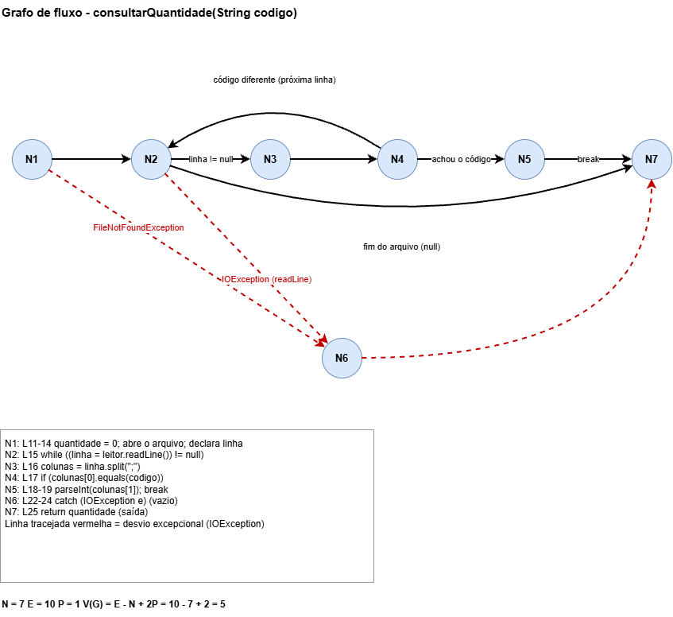

# Atividade Individual – Teste de Caixa Branca e Revisão de Código-Fonte

**Aluno:** Matheus Bau Nardi
**Curso:** Análise e Desenvolvimento de Sistemas – UniFacens
**Disciplina:** UX/UI e Testes de Software

---

## 1. Introdução

Esta atividade consiste em analisar um código Java com problemas, estudar a estrutura interna dele, testar e depois corrigir.

O cenário que recebi foi o **Cenário 2: estoque por arquivo CSV**, com a classe `EstoqueArquivo`. Ela tem dois métodos principais:

- `consultarQuantidade(String codigo)`: lê o arquivo `estoque.csv` e devolve a quantidade do produto.
- `registrarSaida(String codigo, int quantidade)`: verifica se existe saldo e, se existir, registra a saída no arquivo `movimentacoes.txt`.

Também existe o método `getUltimaMovimentacao()`, que só devolve o código da última saída registrada (não precisa de grafo).

### Estrutura do repositório

```
atividade-caixa-branca/
├── original/            código-base sem alterações
├── revisado/            código revisado (Etapa 3)
├── testes/              testes (Etapa 3)
├── diagramas/           grafos de fluxo (Etapa 2)
├── evidencias/          prints e saídas de terminal
├── PLANO_DE_TESTE.xlsx  planilha (aba CAIXA BRANCA (ESTÁTICO))
└── README.md            este relatório
```

---

## 2. Instruções de execução

Todos os comandos abaixo são executados no terminal, na **raiz do projeto** (a pasta que
contém `original`, `testes` e `evidencias`). É preciso ter o JDK instalado (usei o Java 21).

**Código original:** a classe `EstoqueArquivo` não tem método `main`, então ela não executa
sozinha. Ela é feita para ser chamada por outra classe ou por testes. Para só conferir que
compila, rodo:

```
javac original\EstoqueArquivo.java
```

**Testes do código original:** o programa `testes/TestesOriginal.java` roda os 18 casos
de teste da seção 7. Para compilar e executar:

```
javac -d testes\out original\EstoqueArquivo.java testes\TestesOriginal.java
java -cp testes\out TestesOriginal
```

O resultado aparece no terminal e também é gravado em
`evidencias/saida_testes_original.txt`. Cada caso roda em uma pasta temporária, então
os arquivos `estoque.csv` e `movimentacoes.txt` são criados do zero e nada fica sujo no projeto.

**Versão revisada e seus testes:** *(será preenchido na Etapa 3)*

---

## 3. Análise estática

A análise completa está na planilha `PLANO_DE_TESTE.xlsx`, na aba **CAIXA BRANCA (ESTÁTICO)**. Foram verificados 19 itens. Destes, 14 estão com problema (2 críticos, 3 altos, 5 médios e 4 baixos).

Os principais problemas que encontrei no código original:

**1. O saldo nunca diminui (crítico) – `registrarSaida`, linhas 28 a 41**
A saída só é gravada em `movimentacoes.txt`, mas `consultarQuantidade` lê apenas `estoque.csv`. Por isso a mesma saída pode ser registrada várias vezes, mesmo acima do saldo.

**2. Gravação sem garantia de que foi salva (crítico) – linhas 32 a 35**

```java
FileWriter escrita = new FileWriter("movimentacoes.txt", true);
escrita.write(codigo + ";" + quantidade + "\n");
ultimaMovimentacao = codigo;
return true;
```

Não existe `close()` nem `flush()`, mas o método retorna `true`. A movimentação pode não ser gravada no arquivo e o sistema avisa que deu certo.

**3. Erros ignorados (alto) – linhas 22 a 24 e 36 a 38**

```java
} catch (IOException e) {
    // Erro de leitura ignorado.
}
```

Se o arquivo não existir, o método devolve 0, igual a um estoque zerado. Se a gravação falhar, devolve `false`, igual a saldo insuficiente. A informação passada não é a que realmente aconteceu.

**4. Arquivos nunca fechados (alto) – linhas 13 e 32**
O `BufferedReader` e o `FileWriter` não são fechados, nem quando acontece `break` ou um erro.

**5. Falta de validação da entrada (alto) – linha 30**
O `if (quantidade <= disponivel)` aceita quantidade 0 e valores negativos. Como um código que não existe retorna 0, a chamada `registrarSaida("XYZ", 0)` retorna `true`.

**6. Leitura do CSV sem cuidado (médio) – linhas 16 a 18**
O código usa `colunas[1]` sem checar se a linha tem duas colunas e converte com `Integer.parseInt` sem tratar valores que não são número. Uma linha mal formada gera erro sem tratamento.

**Outros pontos** (resumidos na planilha): possível problema de acesso ao mesmo tempo (concorrência), código do produto sem filtro (pode bagunçar o arquivo), nomes de arquivo fixos no código, o arquivo `estoque.csv` é lido inteiro a cada consulta, falta de documentação nos métodos e classe com várias responsabilidades.

---

## 4. Grafos de fluxo e convenções

**Convenções usadas:**
- Cada nó é um bloco de comandos em sequência ou uma decisão (`if`, `while`).
- O `return` é o nó de saída. Quando há mais de um `return`, as saídas se juntam em um nó único.
- O `break` foi contado como uma aresta que sai do laço.
- Foi modelado o desvio para o `catch` de `IOException`, porque é a única exceção capturada. Esses desvios aparecem tracejados em vermelho.
- `NumberFormatException` e `ArrayIndexOutOfBoundsException` (linha 18) não foram modeladas, porque o código não as captura.

**Como os dois métodos se relacionam:** o `registrarSaida` chama o `consultarQuantidade` logo no primeiro nó (N1). Quando a consulta falha por erro de leitura, ela devolve 0, e esse 0 entra na decisão do `if` do `registrarSaida`. Por isso um erro de leitura pode acabar virando "saldo insuficiente".

### 4.1 Método `consultarQuantidade`

| Nó | Linhas | Descrição |
|---|---|---|
| N1 | 11 a 14 | `quantidade = 0`, abre o arquivo e declara `linha` |
| N2 | 15 | `while ((linha = leitor.readLine()) != null)` |
| N3 | 16 | `colunas = linha.split(";")` |
| N4 | 17 | `if (colunas[0].equals(codigo))` |
| N5 | 18 e 19 | `parseInt(...)` e `break` |
| N6 | 22 a 24 | `catch (IOException e)` |
| N7 | 25 | `return quantidade` |

**Arestas:** N1→N2, N2→N3, N3→N4, N4→N5, N4→N2, N5→N7 (`break`), N2→N7 (fim do arquivo).
**Arestas excepcionais:** N1→N6 (arquivo não encontrado), N2→N6 (falha em `readLine`), N6→N7.



### 4.2 Método `registrarSaida`

| Nó | Linhas | Descrição |
|---|---|---|
| N1 | 29 | `disponivel = consultarQuantidade(codigo)` |
| N2 | 30 | `if (quantidade <= disponivel)` |
| N3 | 32 e 33 | abre o `FileWriter` e escreve |
| N4 | 34 e 35 | `ultimaMovimentacao = codigo` e `return true` |
| N5 | 36 a 38 | `catch (IOException e)` |
| N6 | 40 | `return false` |
| N7 | - | saída única (une os dois `return`) |

**Arestas:** N1→N2, N2→N3 (saldo suficiente), N2→N6 (saldo insuficiente), N3→N4, N4→N7, N6→N7.
**Arestas excepcionais:** N3→N5 (IOException ao abrir ou escrever), N5→N6.


Os arquivos-fonte dos grafos (`.drawio`) estão na pasta `diagramas/`.

## 5. Cálculo de V(G) por método

Fórmula usada: **V(G) = E − N + 2P**, com P = 1, porque cada grafo tem um único componente conectado.

| Método | N | E | P | V(G) = E − N + 2P | Regiões | D + 1 |
|---|---|---|---|---|---|---|
| `consultarQuantidade` | 7 | 10 | 1 | 10 − 7 + 2 = **5** | 5 | 4 + 1 = 5 |
| `registrarSaida` | 7 | 8 | 1 | 8 − 7 + 2 = **3** | 3 | 2 + 1 = 3 |

### 5.1 `consultarQuantidade`

**Verificação por regiões (4 internas + a externa = 5):**
- R1: o laço formado por N2, N3 e N4 (aresta de volta N4→N2).
- R2: entre o caminho N2→N3→N4→N5→N7 e a aresta direta N2→N7 (fim do arquivo).
- R3: entre N2→N7, N2→N6 e N6→N7.
- R4: o triângulo formado por N1, N2 e N6.
- R5: a região externa, fora do grafo.

**Verificação por decisões (D + 1):** são 4 decisões binárias: o `if` (N4), o `while` (N2, que tem 3 saídas e conta como 2 decisões: continuar ou sair, e o desvio de `IOException`) e o desvio de `IOException` em N1. Logo D = 4 e V(G) = 4 + 1 = 5.

Se os desvios excepcionais não fossem modelados, V(G) seria 3 (só o `while` e o `if`).

### 5.2 `registrarSaida`

**Verificação por regiões (2 internas + a externa = 3):**
- R1: formada por N2, N3, N5 e N6.
- R2: formada por N3, N4, N7, N6 e N5.
- R3: a região externa.

**Verificação por decisões (D + 1):** são 2 decisões binárias: o `if` (N2) e o desvio de `IOException` em N3. Logo D = 2 e V(G) = 2 + 1 = 3.

Se o desvio excepcional não fosse modelado, V(G) seria 2.

### Convenções aplicadas
- O código não tem `switch`, então essa convenção não se aplica.
- Cada desvio para o `catch` foi contado como uma decisão adicional.
- O `break` e os `return` foram contados na topologia (N5→N7, N4→N7 e N6→N7).
- Os valores foram calculados sobre o código original, antes das correções.

## 6. Caminhos básicos

Para cada método eu escolhi um conjunto de caminhos independentes. Cada caminho passa por
pelo menos uma aresta que os anteriores ainda não tinham usado, e a quantidade de caminhos
é igual ao V(G) do método. Eu não listei todos os caminhos possíveis, principalmente por causa
do laço `while`, que poderia repetir várias vezes. O conjunto que escolhi não é o único
possível, mas o tamanho dele é sempre o mesmo. Tudo foi feito sobre o código original.

### 6.1 Método `consultarQuantidade` (V(G) = 5, então 5 caminhos)

| Caminho | Nós percorridos | Quando acontece | Aresta nova |
|---|---|---|---|
| P1 | N1 → N2 → N7 | O `estoque.csv` existe, mas está vazio. O `while` termina na primeira leitura e o método devolve 0. | N1→N2, N2→N7 |
| P2 | N1 → N2 → N3 → N4 → N5 → N7 | O código procurado está na primeira linha. O método converte a quantidade e sai pelo `break`. | N2→N3, N3→N4, N4→N5, N5→N7 |
| P3 | N1 → N2 → N3 → N4 → N2 → N7 | O arquivo tem linhas, mas nenhuma com o código procurado. O laço lê tudo e devolve 0. | N4→N2 |
| P4 | N1 → N6 → N7 | O `estoque.csv` não existe (`FileNotFoundException`). Cai no `catch` vazio e devolve 0. | N1→N6, N6→N7 |
| P5 | N1 → N2 → N6 → N7 | Dá erro de leitura (`IOException`) no meio do `readLine`. Cai no `catch` vazio e devolve 0. | N2→N6 |

Observações:
- P1, P3, P4 e P5 devolvem 0 e o chamador não consegue saber qual foi o motivo. Isso é o problema do `catch` vazio que apontei na análise estática.
- O P5 é difícil de provocar com um arquivo de verdade, e por isso vou tratá-lo na seção 7.
- Para testar o laço, além dos 5 caminhos, também vou usar: zero iterações (P1), uma iteração (P2), várias iterações (código na 3ª linha, que repete N2 → N3 → N4 → N2) e o código na última linha do arquivo.

### 6.2 Método `registrarSaida` (V(G) = 3, então 3 caminhos)

| Caminho | Nós percorridos | Quando acontece | Aresta nova |
|---|---|---|---|
| P1 | N1 → N2 → N6 → N7 | A quantidade pedida é maior que o saldo. Não grava nada e devolve `false`. | N1→N2, N2→N6, N6→N7 |
| P2 | N1 → N2 → N3 → N4 → N7 | A quantidade é menor ou igual ao saldo e a gravação funciona. Atualiza `ultimaMovimentacao` e devolve `true`. | N2→N3, N3→N4, N4→N7 |
| P3 | N1 → N2 → N3 → N5 → N6 → N7 | A quantidade é menor ou igual ao saldo, mas a gravação dá `IOException`. Cai no `catch` vazio e devolve `false`. | N3→N5, N5→N6 |

No P3, o método devolve `false` igual ao P1, mas por outro motivo. Quem chama não consegue
diferenciar saldo insuficiente de falha na gravação.

### 6.3 Como os dois métodos se influenciam

O `registrarSaida` chama o `consultarQuantidade` logo no começo (N1), então o caminho que a
consulta faz muda o caminho do `registrarSaida`. Dois exemplos com o arquivo `estoque.csv`
inexistente (P4 da consulta, que devolve 0):
- `registrarSaida("A001", 5)` cai no P1 (saldo insuficiente), mas o motivo real é que o arquivo não existe.
- `registrarSaida("A001", 0)` cai no P2 e devolve `true`, mesmo sem o produto e sem o arquivo.

## 7. Matriz de casos de teste e resultados

Montei os casos de teste a partir dos caminhos básicos da seção 6, e incluí casos normais,
de limite, de erro e de entrada inválida.

O "resultado esperado" é o comportamento **correto** que o método deveria ter, e não o que o
código original faz hoje. Quando o original não faz isso, o teste falha, e essa falha comprova
o defeito encontrado na análise estática.

**Arquivo padrão usado nos testes** (`estoque.csv`):

```
A001;10
B002;0
C003;25
```

### 7.1 Casos de teste planejados

| ID | Método | Caminho | Entrada | Pré-condição | Resultado esperado |
|---|---|---|---|---|---|
| CT01 | `consultarQuantidade` | P1 | `"A001"` | `estoque.csv` existe e está vazio | retorna 0 |
| CT02 | `consultarQuantidade` | P2 | `"A001"` | arquivo padrão | retorna 10 (código na 1ª linha) |
| CT03 | `consultarQuantidade` | P2 (laço com várias iterações) | `"C003"` | arquivo padrão | retorna 25 (código na 3ª linha) |
| CT04 | `consultarQuantidade` | P3 | `"Z999"` | arquivo padrão | retorna 0 (produto sem saldo) |
| CT05 | `consultarQuantidade` | P4 | `"A001"` | `estoque.csv` não existe | informa o erro ao chamador (não retorna 0 como se fosse saldo) |
| CT06 | `consultarQuantidade` | P5 | `"A001"` | falha de leitura no meio do arquivo (`IOException`) | informa o erro ao chamador (não retorna 0) |
| CT07 | `consultarQuantidade` | P2 (limite) | `"A001"` | arquivo com a linha `A001` (sem `;`) | trata a linha inválida, sem estourar `ArrayIndexOutOfBoundsException` |
| CT08 | `consultarQuantidade` | P2 (limite) | `"A001"` | arquivo com a linha `A001;abc` | trata o valor inválido, sem estourar `NumberFormatException` |
| CT09 | `consultarQuantidade` | P3 | `null` | arquivo padrão | rejeita a entrada inválida com erro claro |
| CT10 | `registrarSaida` | P2 | `"A001"`, 5 | arquivo padrão | retorna `true`, grava `A001;5` em `movimentacoes.txt` e `ultimaMovimentacao` = `A001` |
| CT11 | `registrarSaida` | P2 (limite) | `"A001"`, 10 | arquivo padrão | retorna `true` (quantidade igual ao saldo) e grava a linha |
| CT12 | `registrarSaida` | P1 (limite) | `"A001"`, 11 | arquivo padrão | retorna `false` e não grava nada |
| CT13 | `registrarSaida` | P3 | `"A001"`, 5 | `movimentacoes.txt` não pode ser gravado (`IOException`) | informa a falha de gravação (diferente de saldo insuficiente) e `ultimaMovimentacao` não muda |
| CT14 | `registrarSaida` | P2 (entrada inválida) | `"A001"`, 0 | arquivo padrão | rejeita (quantidade deve ser maior que 0) e não grava |
| CT15 | `registrarSaida` | P2 (entrada inválida) | `"A001"`, -5 | arquivo padrão | rejeita e não grava |
| CT16 | `registrarSaida` | P2 (entrada inválida) | `"Z999"`, 0 | arquivo padrão (produto não existe) | rejeita, porque o produto não existe |
| CT17 | `registrarSaida` | P2 duas vezes | `"A001"`, 10 e depois `"A001"`, 10 | arquivo padrão (saldo 10) | 1ª retorna `true`, 2ª retorna `false` (o saldo já acabou) |
| CT18 | `registrarSaida` + `consultarQuantidade` | P1 da consulta (P4) e P2 | `"A001"`, 0 | `estoque.csv` não existe | rejeita ou informa erro (não retorna `true`) |

### 7.2 Resultados da execução

Para executar os testes do código original, abro o terminal na raiz do projeto e rodo:

```
javac -d testes\out original\EstoqueArquivo.java testes\TestesOriginal.java
java -cp testes\out TestesOriginal
```

A saída completa está em `evidencias/saida_testes_original.txt`.

**Resultado no código original:** 5 testes passaram, 12 falharam e 1 não pôde ser executado.

| ID | Resultado observado (original) | Situação (original) | Evidência |
|---|---|---|---|
| CT01 | retorno = 0 | Passou | `evidencias/saida_testes_original.txt` |
| CT02 | retorno = 10 | Passou | idem |
| CT03 | retorno = 25 | Passou | idem |
| CT04 | retorno = 0 | Passou | idem |
| CT05 | retorno = 0 (arquivo inexistente, sem aviso de erro) | **Falhou** | idem |
| CT06 | não há como injetar um leitor que falhe no original | Não executado | idem |
| CT07 | `ArrayIndexOutOfBoundsException` | **Falhou** | idem |
| CT08 | `NumberFormatException` | **Falhou** | idem |
| CT09 | retorno = 0 (código nulo aceito) | **Falhou** | idem |
| CT10 | retorno = `true`, mas `movimentacoes.txt` ficou vazio | **Falhou** | idem |
| CT11 | retorno = `true`, mas `movimentacoes.txt` ficou vazio | **Falhou** | idem |
| CT12 | retorno = `false`, nada gravado | Passou | idem |
| CT13 | retorno = `false` (falha de gravação sem aviso) | **Falhou** | idem |
| CT14 | retorno = `true` com quantidade 0 | **Falhou** | idem |
| CT15 | retorno = `true` com quantidade negativa | **Falhou** | idem |
| CT16 | retorno = `true` para código inexistente | **Falhou** | idem |
| CT17 | 1ª e 2ª saídas retornaram `true`; `estoque.csv` continuou com `A001;10` | **Falhou** | idem |
| CT18 | retorno = `true` com o arquivo inexistente | **Falhou** | idem |

**Resultado no código revisado:** *(será preenchido na Etapa 3)*

**O que os resultados mostram:**
- Os casos normais (CT01 a CT04 e CT12) passam, então o código funciona quando tudo dá certo.
- CT10 e CT11 comprovam que o `FileWriter` não é fechado: o método avisa que deu certo, mas a movimentação não é gravada.
- CT17 comprova que o saldo nunca diminui.
- CT05, CT13 e CT18 comprovam que os `catch` vazios escondem os erros.
- CT14, CT15 e CT16 comprovam a falta de validação da quantidade.
- CT07 e CT08 comprovam que linhas mal formadas estouram exceções sem tratamento.

### 7.3 Caminhos difíceis de provocar e como simular

- **P5 de `consultarQuantidade` (erro no meio da leitura):** com um arquivo de verdade quase
  não dá para forçar. No original também não, porque o nome do arquivo está fixo dentro do
  método. Na versão revisada, vou receber o leitor de fora (injeção) e usar um *test double*
  (uma classe falsa que lança `IOException` no `readLine`).
- **P3 de `registrarSaida` (erro de gravação):** dá para simular no original transformando
  `movimentacoes.txt` em uma **pasta** com o mesmo nome (o `FileWriter` falha ao abrir) ou
  deixando o arquivo somente leitura. Na revisada, também posso usar um escritor falso.
- **P4 (arquivo inexistente):** é fácil, basta não criar o `estoque.csv`.
- **Condição de corrida (duas saídas ao mesmo tempo):** é difícil de provocar de forma
  confiável. Eu simularia com duas threads chamando `registrarSaida` ao mesmo tempo.

## 8. Correções implementadas e comparação antes/depois

*(será preenchido na Etapa 3)*

## 9. Limitações

*(será preenchido ao final)*

## 10. Conclusão e referências

*(a conclusão será preenchida ao final)*

**Referências**

- Slides da aula 10 – UX/UI e Testes de Software (UniFacens).
- PRESSMAN, Roger S.; MAXIM, Bruce R. *Engenharia de Software: Uma Abordagem Profissional*. 8. ed. Porto Alegre: AMGH Editora, 2016.
