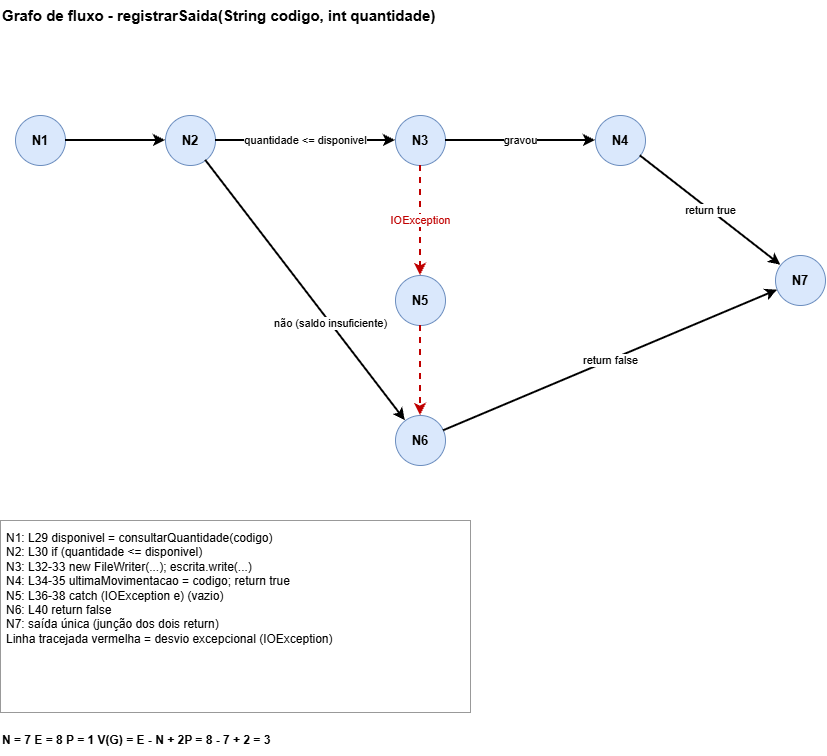

# Atividade Individual – Teste de Caixa Branca e Revisão de Código-Fonte

**Aluno:** Matheus Bau Nardi
**Curso:** Análise e Desenvolvimento de Sistemas – UniFacens
**Disciplina:** UX/UI e Testes de Software

---

## 1. Introdução

Nesta atividade eu peguei um código Java que tem vários problemas de propósito. Primeiro li o código procurando os erros, depois desenhei o caminho que cada método segue, montei testes a partir desses caminhos e por fim criei uma versão corrigida para comparar com a original.

O cenário que recebi foi o **Cenário 2: estoque por arquivo CSV**. A classe é a `EstoqueArquivo` e ela usa dois arquivos:

- `estoque.csv`: guarda o estoque, com uma linha por produto no formato `codigo;quantidade` (por exemplo `A001;10`).
- `movimentacoes.txt`: é onde as saídas de estoque são registradas.

Os métodos da classe são:

- `consultarQuantidade(String codigo)`: lê o `estoque.csv` e devolve a quantidade do produto.
- `registrarSaida(String codigo, int quantidade)`: confere se tem saldo e, se tiver, registra a saída no `movimentacoes.txt`.
- `getUltimaMovimentacao()`: só devolve o código da última saída registrada. Como o enunciado diz que os métodos `get` não precisam de grafo, ele ficou de fora.

### Estrutura do repositório

```
atividade-caixa-branca/
├── original/            código-base sem alterações
├── revisado/            código revisado
├── testes/              programas de teste
├── diagramas/           grafos de fluxo (imagens e arquivos do draw.io)
├── evidencias/          saídas dos testes
├── PLANO_DE_TESTE.xlsx  planilha (aba CAIXA BRANCA (ESTÁTICO))
└── README.md            este relatório
```

---

## 2. Instruções de execução

Os comandos abaixo são para o terminal do Windows e devem ser executados na **raiz do projeto** (a pasta que tem `original`, `revisado`, `testes` e `evidencias`). É preciso ter o JDK instalado, eu usei o Java 21. Não usei biblioteca de teste, só Java puro.

**Código original:** a classe `EstoqueArquivo` não tem método `main`, então ela não roda sozinha. Ela foi feita para ser chamada por outra classe ou por testes. Para só ver se compila:

```
javac original\EstoqueArquivo.java
```

**Testes do código original:** o programa `testes/TestesOriginal.java` roda os 18 casos de teste da seção 7.

```
javac -d testes\out original\EstoqueArquivo.java testes\TestesOriginal.java
java -cp testes\out TestesOriginal
```

O resultado fica gravado em `evidencias/saida_testes_original.txt`.

**Versão revisada e seus testes:** o programa `testes/TestesRevisado.java` roda os mesmos 18 casos e mais 2 que só fazem sentido na versão revisada (CT19 e CT20).

```
javac -d testes\out_revisado revisado\EstoqueArquivo.java testes\TestesRevisado.java
java -cp testes\out_revisado TestesRevisado
```

O resultado fica gravado em `evidencias/saida_testes_revisado.txt`. As duas versões têm uma classe com o mesmo nome, por isso cada uma é compilada em uma pasta de saída diferente.

Cada caso de teste roda em um processo separado e em uma pasta temporária nova. Fiz assim para um teste não atrapalhar o outro, já que o código original deixa arquivos abertos. Também faz com que o `estoque.csv` e o `movimentacoes.txt` sejam criados do zero a cada teste, sem sujar o projeto.

---

## 3. Análise estática

A lista completa está na planilha `PLANO_DE_TESTE.xlsx`, na aba **CAIXA BRANCA (ESTÁTICO)**. Eu olhei 19 itens e 14 tinham problema (2 críticos, 3 altos, 5 médios e 4 baixos).

**Como classifiquei a gravidade:**

- **Crítica:** o sistema perde dados ou quebra a regra principal em uso normal, sem avisar ninguém.
- **Alta:** pode acontecer em uso normal e faz o sistema seguir com dados falsos ou aceitar valores inválidos, mas depende de uma falha externa ou de quem chama o método.
- **Média:** só acontece em situações menos comuns (arquivo editado à mão, acesso ao mesmo tempo, entrada maliciosa) ou atrapalha os testes e a evolução do código.
- **Baixa:** não causa falha nem perda de dados, só afeta manutenção, portabilidade ou desempenho.

Na planilha, cada ocorrência tem o motivo da gravidade. Quando algum teste da seção 7 prova o problema, eu citei o número dele (CT).

Os principais problemas que encontrei no código original:

**1. O saldo nunca diminui (crítico), `registrarSaida`, linhas 28 a 41**
A saída só é gravada no `movimentacoes.txt`, mas o `consultarQuantidade` lê apenas o `estoque.csv`. Então o saldo que ele enxerga nunca muda e a mesma saída pode ser registrada várias vezes, até passar do que existe. Provado pelo CT17.

**2. Diz que gravou sem ter gravado (crítico), linhas 32 a 35**

```java
FileWriter escrita = new FileWriter("movimentacoes.txt", true);
escrita.write(codigo + ";" + quantidade + "\n");
ultimaMovimentacao = codigo;
return true;
```

O `FileWriter` nunca é fechado e não tem `flush()`, mas o método já devolve `true`. O texto pode ficar só na memória e nunca chegar ao arquivo. Provado pelo CT10 e CT11.

**3. Erros ignorados (alto), linhas 22 a 24 e 36 a 38**

```java
} catch (IOException e) {
    // Erro de leitura ignorado.
}
```

Os dois `catch` estão vazios. Se o `estoque.csv` não existir, o método devolve 0, igual a um estoque zerado. Se a gravação falhar, devolve `false`, igual a saldo insuficiente. Quem chama não tem como saber o que aconteceu de verdade. Provado pelo CT05 e CT13.

**4. Arquivos nunca fechados (alto), linhas 13 e 32**
O `BufferedReader` e o `FileWriter` ficam abertos, até quando acontece um `break` ou um erro. O próprio VS Code mostra aviso nessas duas linhas.

**5. Falta de validação da entrada (alto), linha 30**
O `if (quantidade <= disponivel)` aceita quantidade 0 e negativa. Como um código que não existe devolve 0, a chamada `registrarSaida("XYZ", 0)` retorna `true`. Provado pelo CT14, CT15 e CT16.

**6. Leitura do CSV sem cuidado (médio), linhas 16 a 18**
O código usa `colunas[1]` sem ver se a linha tem duas colunas e usa o `Integer.parseInt` sem tratar um valor que não é número. Uma linha com problema gera um erro que ninguém trata. Provado pelo CT07 e CT08.

**Outros pontos** (estão na planilha): possível problema com acesso ao mesmo tempo, código do produto sem filtro (um `;` poderia bagunçar o arquivo), nomes de arquivo fixos no código, o `estoque.csv` é lido inteiro a cada consulta, falta de documentação nos métodos e uma classe só com várias responsabilidades.

---

## 4. Grafos de fluxo e convenções

Convenções que usei:

- Cada nó é um bloco de comandos em sequência ou uma decisão (`if`, `while`).
- O `return` é o nó de saída. Quando o método tem mais de um `return`, as saídas se juntam em um nó só.
- O `break` entrou como uma aresta que sai do laço.
- Eu modelei o desvio para o `catch` de `IOException`, porque é a única exceção que o código captura. Esses desvios aparecem tracejados em vermelho nos desenhos.
- `NumberFormatException` e `ArrayIndexOutOfBoundsException` (linha 18) **não** foram modeladas, porque o código não captura essas exceções.

Os dois métodos se ligam assim: o `registrarSaida` chama o `consultarQuantidade` logo no primeiro nó (N1). Quando a consulta dá erro de leitura, ela devolve 0 e esse 0 vai para o `if` do `registrarSaida`. Ou seja, um erro de leitura pode acabar virando "saldo insuficiente".

### 4.1 Método `consultarQuantidade`

| Nó | Linhas | Descrição |
|---|---|---|
| N1 | 11 a 14 | `quantidade = 0`, abre o arquivo e declara `linha` |
| N2 | 15 | `while ((linha = leitor.readLine()) != null)` |
| N3 | 16 | `colunas = linha.split(";")` |
| N4 | 17 | `if (colunas[0].equals(codigo))` |
| N5 | 18 e 19 | `parseInt(...)` e `break` |
| N6 | 22 a 24 | `catch (IOException e)` |
| N7 | 25 | `return quantidade` |

**Arestas:** N1→N2, N2→N3, N3→N4, N4→N5, N4→N2, N5→N7 (`break`), N2→N7 (fim do arquivo).
**Arestas excepcionais:** N1→N6 (arquivo não encontrado), N2→N6 (falha no `readLine`), N6→N7.


### 4.2 Método `registrarSaida`

| Nó | Linhas | Descrição |
|---|---|---|
| N1 | 29 | `disponivel = consultarQuantidade(codigo)` |
| N2 | 30 | `if (quantidade <= disponivel)` |
| N3 | 32 e 33 | abre o `FileWriter` e escreve |
| N4 | 34 e 35 | `ultimaMovimentacao = codigo` e `return true` |
| N5 | 36 a 38 | `catch (IOException e)` |
| N6 | 40 | `return false` |
| N7 | - | saída única (junta os dois `return`) |

**Arestas:** N1→N2, N2→N3 (saldo suficiente), N2→N6 (saldo insuficiente), N3→N4, N4→N7, N6→N7.
**Arestas excepcionais:** N3→N5 (`IOException` ao abrir ou escrever), N5→N6.



Os arquivos do draw.io (`.drawio`) estão na pasta `diagramas/`.

---

## 5. Cálculo de V(G) por método

Usei a fórmula **V(G) = E − N + 2P**. O P vale 1 porque cada grafo tem um único componente conectado.

| Método | N | E | P | V(G) = E − N + 2P | Regiões | D + 1 |
|---|---|---|---|---|---|---|
| `consultarQuantidade` | 7 | 10 | 1 | 10 − 7 + 2 = **5** | 5 | 4 + 1 = 5 |
| `registrarSaida` | 7 | 8 | 1 | 8 − 7 + 2 = **3** | 3 | 2 + 1 = 3 |

### 5.1 `consultarQuantidade`

**Conferindo pelas regiões** (4 internas e a região de fora, total 5):

- R1: o laço formado por N2, N3 e N4 (aresta de volta N4→N2).
- R2: entre o caminho N2→N3→N4→N5→N7 e a aresta direta N2→N7 (fim do arquivo).
- R3: entre N2→N7, N2→N6 e N6→N7.
- R4: o triângulo formado por N1, N2 e N6.
- R5: a região de fora do grafo.

**Conferindo pelas decisões (D + 1):** contei 4 decisões binárias. O `if` do N4 vale 1. O N2 (`while`) tem 3 saídas (continuar, fim do arquivo e `IOException`), então vale 2. O desvio de `IOException` que sai do N1 vale 1. Com D = 4, o V(G) é 4 + 1 = 5.

Se eu não tivesse modelado os desvios das exceções, o V(G) seria 3 (só o `while` e o `if`).

### 5.2 `registrarSaida`

**Conferindo pelas regiões** (2 internas e a de fora, total 3):

- R1: formada por N2, N3, N5 e N6.
- R2: formada por N3, N4, N7, N6 e N5.
- R3: a região de fora.

**Conferindo pelas decisões (D + 1):** são 2 decisões, o `if` do N2 e o desvio de `IOException` que sai do N3. Com D = 2, o V(G) é 2 + 1 = 3.

Sem o desvio da exceção, o V(G) seria 2.

### Convenções que apliquei

- O código não tem `switch`, então essa convenção não foi usada.
- Cada desvio para o `catch` foi contado como mais uma decisão.
- O `break` e os `return` entraram na contagem das arestas (N5→N7, N4→N7 e N6→N7).
- Tudo foi calculado sobre o código original, antes das correções.

---

## 6. Caminhos básicos

Para cada método eu escolhi um conjunto de caminhos independentes. Cada caminho passa por pelo menos uma aresta que os anteriores ainda não tinham usado, e a quantidade de caminhos é igual ao V(G) do método. Eu não listei todos os caminhos possíveis, principalmente por causa do `while`, que poderia repetir muitas vezes. O conjunto que escolhi não é o único possível, mas o tamanho dele é sempre o mesmo. Tudo foi feito sobre o código original.

### 6.1 Método `consultarQuantidade` (V(G) = 5, então 5 caminhos)

| Caminho | Nós percorridos | Quando acontece | Aresta nova |
|---|---|---|---|
| P1 | N1 → N2 → N7 | O `estoque.csv` existe, mas está vazio. O `while` termina na primeira leitura e o método devolve 0. | N1→N2, N2→N7 |
| P2 | N1 → N2 → N3 → N4 → N5 → N7 | O código procurado está na primeira linha. O método converte a quantidade e sai pelo `break`. | N2→N3, N3→N4, N4→N5, N5→N7 |
| P3 | N1 → N2 → N3 → N4 → N2 → N7 | O arquivo tem linhas, mas nenhuma com o código procurado. O laço lê tudo e devolve 0. | N4→N2 |
| P4 | N1 → N6 → N7 | O `estoque.csv` não existe (`FileNotFoundException`). Cai no `catch` vazio e devolve 0. | N1→N6, N6→N7 |
| P5 | N1 → N2 → N6 → N7 | Dá erro de leitura (`IOException`) no meio do `readLine`. Cai no `catch` vazio e devolve 0. | N2→N6 |

Observações:

- P1, P3, P4 e P5 devolvem 0, e quem chamou não consegue saber o motivo. É o problema do `catch` vazio que apontei na análise estática.
- O P5 é difícil de provocar com um arquivo de verdade. Como resolvi isso está na seção 7.3.
- Para testar o laço, além dos 5 caminhos, usei também: zero iterações (P1), uma iteração (P2), várias iterações (código na 3ª linha, que repete N2 → N3 → N4 → N2) e código na última linha do arquivo.

### 6.2 Método `registrarSaida` (V(G) = 3, então 3 caminhos)

| Caminho | Nós percorridos | Quando acontece | Aresta nova |
|---|---|---|---|
| P1 | N1 → N2 → N6 → N7 | A quantidade pedida é maior que o saldo. Não grava nada e devolve `false`. | N1→N2, N2→N6, N6→N7 |
| P2 | N1 → N2 → N3 → N4 → N7 | A quantidade é menor ou igual ao saldo e a gravação funciona. Atualiza `ultimaMovimentacao` e devolve `true`. | N2→N3, N3→N4, N4→N7 |
| P3 | N1 → N2 → N3 → N5 → N6 → N7 | A quantidade é menor ou igual ao saldo, mas a gravação dá `IOException`. Cai no `catch` vazio e devolve `false`. | N3→N5, N5→N6 |

No P3 o método devolve `false` igual ao P1, mas por outro motivo. Quem chama não consegue diferenciar saldo insuficiente de falha na gravação.

### 6.3 Como um método influencia o outro

O `registrarSaida` chama o `consultarQuantidade` logo no começo (N1), então o caminho que a consulta faz muda o caminho do `registrarSaida`. Dois exemplos com o `estoque.csv` inexistente (P4 da consulta, que devolve 0):

- `registrarSaida("A001", 5)` cai no P1 (saldo insuficiente), mas o motivo real é que o arquivo não existe.
- `registrarSaida("A001", 0)` cai no P2 e devolve `true`, mesmo sem o produto e sem o arquivo.

---

## 7. Matriz de casos de teste e resultados

Montei os casos de teste a partir dos caminhos básicos da seção 6 e coloquei casos normais, de limite, de erro e de entrada inválida.

O "resultado esperado" é o que o método **deveria** fazer, e não o que o código original faz hoje. Quando o original não faz isso, o teste falha, e essa falha prova o defeito que eu tinha achado na análise estática.

### 7.1 Casos de teste planejados

Usei o modelo de tabela de caso de teste que vimos em aula (Passo, Ação, Resultado esperado) e acrescentei a coluna **Caminho**, que liga cada passo ao caminho básico da seção 6. Cada passo é um caso de teste (CT).

**Arquivo padrão** (`estoque.csv`), usado quando não digo outra coisa:

```
A001;10
B002;0
C003;25
```

**Valores da quantidade de saída** (partição de equivalência e valores limite, com o saldo de `A001` em 10):

| Partição | Valores usados | Casos |
|---|---|---|
| Válida: de 1 até o saldo | 5 e o limite superior 10 | CT10, CT11 |
| Inválida: acima do saldo | 11 (saldo + 1) | CT12 |
| Inválida: zero ou negativa | 0 (limite inferior) e -5 | CT14, CT15 |

**Caso de teste A: consultar o saldo de um produto (`consultarQuantidade`)**

| Passo | Caminho | Ação | Resultado esperado |
|---|---|---|---|
| CT01 | P1 (zero iterações) | Deixar o `estoque.csv` vazio e consultar `"A001"` | Retorna 0 |
| CT02 | P2 (uma iteração) | Usar o arquivo padrão e consultar `"A001"` | Retorna 10 |
| CT03 | P2 (várias iterações) | Usar o arquivo padrão e consultar `"C003"` | Retorna 25 (3ª linha) |
| CT04 | P3 | Usar o arquivo padrão e consultar `"Z999"` | Retorna 0 (produto sem saldo) |
| CT05 | P4 | Não criar o `estoque.csv` e consultar `"A001"` | Informa o erro e não retorna 0 como se fosse saldo |
| CT06 | P5 | Simular `IOException` no meio da leitura (test double) e consultar `"A001"` | Informa o erro e não retorna 0 |

**Caso de teste B: entradas inválidas na consulta**

| Passo | Caminho | Ação | Resultado esperado |
|---|---|---|---|
| CT07 | P2 (limite) | Arquivo com a linha `A001` (sem `;`) e consultar `"A001"` | Trata a linha inválida, sem `ArrayIndexOutOfBoundsException` |
| CT08 | P2 (limite) | Arquivo com a linha `A001;abc` e consultar `"A001"` | Trata o valor, sem `NumberFormatException` |
| CT09 | P3 | Consultar com código `null` | Rejeita a entrada com um erro claro |

**Caso de teste C: validar a quantidade da saída (`registrarSaida`)**

| Passo | Caminho | Ação | Resultado esperado |
|---|---|---|---|
| CT10 | P2 | Registrar saída de `"A001"`, quantidade 5 | Retorna `true`, grava `A001;5` e `ultimaMovimentacao` fica `A001` |
| CT11 | P2 (limite) | Registrar saída de `"A001"`, quantidade 10 | Retorna `true` e grava a linha |
| CT12 | P1 (limite) | Registrar saída de `"A001"`, quantidade 11 | Retorna `false` e não grava nada |
| CT14 | P2 (inválida) | Registrar saída de `"A001"`, quantidade 0 | Rejeita e não grava |
| CT15 | P2 (inválida) | Registrar saída de `"A001"`, quantidade -5 | Rejeita e não grava |
| CT16 | P2 (inválida) | Registrar saída de `"Z999"`, quantidade 0 | Rejeita, porque o produto não existe |

**Caso de teste D: falhas e regra do saldo (`registrarSaida`)**

| Passo | Caminho | Ação | Resultado esperado |
|---|---|---|---|
| CT13 | P3 | Fazer o `movimentacoes.txt` não poder ser gravado (`IOException`) e registrar `"A001"`, 5 | Informa a falha de gravação (diferente de saldo insuficiente) e `ultimaMovimentacao` não muda |
| CT17 | P2 duas vezes | Registrar `"A001"`, 10 e logo depois `"A001"`, 10 | A 1ª retorna `true` e a 2ª retorna `false` (o saldo acabou) |
| CT18 | P4 da consulta e P2 | Não criar o `estoque.csv` e registrar `"A001"`, 0 | Rejeita ou informa o erro, não retorna `true` |
| CT19 (só revisada) | P2 | Registrar `"A001;999"`, 1 | Rejeita (o código tem `;`) e não grava |
| CT20 (só revisada) | P2 com acesso ao mesmo tempo | 8 threads, cada uma registrando `"A001"`, 5 | Só 2 saídas são aceitas e o arquivo fica com 2 linhas |

O CT19 e o CT20 eu criei depois, só para provar correções da versão revisada. Nos casos CT06 e CT13 da versão revisada, a falha de leitura e a de gravação são simuladas com *test doubles* (explico na seção 7.3).

### 7.2 Resultados da execução

Rodei os testes no mesmo computador (Windows, Java 21) nas duas versões. As saídas completas estão em `evidencias/saida_testes_original.txt` e `evidencias/saida_testes_revisado.txt`.

**Resumo:** no código original, 5 testes passaram, 12 falharam e 1 não deu para executar. No código revisado, os 20 testes passaram.

| ID | Observado no original | Situação (original) | Observado no revisado | Situação (revisado) |
|---|---|---|---|---|
| CT01 | retorno = 0 | Passou | retorno = 0 | Passou |
| CT02 | retorno = 10 | Passou | retorno = 10 | Passou |
| CT03 | retorno = 25 | Passou | retorno = 25 | Passou |
| CT04 | retorno = 0 | Passou | retorno = 0 | Passou |
| CT05 | retorno = 0, sem aviso de erro | **Falhou** | `NoSuchFileException` | Passou |
| CT06 | não dá para simular no original | Não executado | `IOException` (test double) | Passou |
| CT07 | `ArrayIndexOutOfBoundsException` | **Falhou** | `IOException` com mensagem clara | Passou |
| CT08 | `NumberFormatException` | **Falhou** | `IOException` com mensagem clara | Passou |
| CT09 | retorno = 0 (código nulo aceito) | **Falhou** | `IllegalArgumentException` | Passou |
| CT10 | `true`, mas `movimentacoes.txt` vazio | **Falhou** | `true` e arquivo com `A001;5` | Passou |
| CT11 | `true`, mas `movimentacoes.txt` vazio | **Falhou** | `true` e arquivo com `A001;10` | Passou |
| CT12 | `false`, nada gravado | Passou | `false`, nada gravado | Passou |
| CT13 | `false`, falha de gravação sem aviso | **Falhou** | `IOException` | Passou |
| CT14 | `true` com quantidade 0 | **Falhou** | `IllegalArgumentException` | Passou |
| CT15 | `true` com quantidade negativa | **Falhou** | `IllegalArgumentException` | Passou |
| CT16 | `true` para código inexistente | **Falhou** | `IllegalArgumentException` | Passou |
| CT17 | 1ª e 2ª saídas `true`; `estoque.csv` não mudou | **Falhou** | 1ª `true` e 2ª `false` | Passou |
| CT18 | `true` com o arquivo inexistente | **Falhou** | `IllegalArgumentException` | Passou |
| CT19 | não executado (caso só da revisada) | - | `IllegalArgumentException`, nada gravado | Passou |
| CT20 | não executado (caso só da revisada) | - | 2 saídas aceitas de 8; arquivo com 2 linhas | Passou |

O que dá para ver nos resultados:

- Os casos normais passam nas duas versões, então a revisão não estragou o que já funcionava.
- O CT10 e o CT11 mostram o problema do arquivo não fechado: o original diz que deu certo, mas o `movimentacoes.txt` fica vazio. Na revisada a linha é gravada.
- O CT17 mostra que no original o saldo nunca diminuía, e na revisada ele diminui.

### 7.3 Caminhos difíceis de provocar e como simulei

- **P5 do `consultarQuantidade` (erro no meio da leitura):** no original não dá para simular, porque o nome do arquivo está fixo e o leitor é criado dentro do método. Na revisada o leitor é aberto em um método separado (`abrirLeitor`), e o CT06 usa uma subclasse que devolve um leitor que lança `IOException`.
- **P3 do `registrarSaida` (erro de gravação):** no original simulei transformando o `movimentacoes.txt` em uma pasta com o mesmo nome. Na revisada, o CT13 usa uma subclasse que troca o `abrirEscritor` por um que lança `IOException`, para a falha acontecer exatamente na gravação.
- **P4 (arquivo inexistente):** é fácil, basta não criar o `estoque.csv`.
- **Acesso ao mesmo tempo:** o CT20 chama o `registrarSaida` em 8 threads ao mesmo tempo.

---

## 8. Correções implementadas e comparação antes/depois

A versão revisada está em `revisado/EstoqueArquivo.java`, com comentários `CORREÇÃO:` nos pontos que mudei. O original continua sem alterações em `original/`. Corrigi os problemas mais graves da análise estática e agora nenhum erro fica escondido por `catch` vazio.

### 8.1 O que corrigi

| Problema no original (item da planilha) | O que fiz na revisada | Teste que prova |
|---|---|---|
| Saldo nunca diminui (13) | O saldo passou a ser o `estoque.csv` menos a soma das saídas do `movimentacoes.txt` | CT17, CT20 |
| Arquivos não fechados e gravação sem `flush` (9 e 14) | Usei `try-with-resources`, que fecha os arquivos. O `return true` só vem depois de gravar | CT10, CT11 |
| `catch` vazios e retornos `0`/`false` ambíguos (8 e 12) | Os erros de arquivo chegam até quem chamou como `IOException` (os métodos agora têm `throws IOException`) | CT05, CT06, CT13, CT18 |
| Entrada sem validação (10) | Código nulo, vazio ou com `;`/quebra de linha, e quantidade menor ou igual a 0, geram `IllegalArgumentException` | CT09, CT14, CT15, CT16 |
| Leitura do CSV sem cuidado (11) | Confere o número de colunas e trata o `parseInt`. Linha inválida gera `IOException` com o número da linha | CT07, CT08 |
| Código podia bagunçar o arquivo (15) | Rejeita `;` e quebra de linha no código | CT19 |
| Duas saídas ao mesmo tempo (16) | Métodos `synchronized` | CT20 |
| Nomes de arquivo, charset e quebra de linha fixos (17) | Caminhos recebidos pelo construtor, UTF-8 e `System.lineSeparator()` | só pela leitura do código |
| Falta de documentação (1) | Javadoc na classe e nos métodos | só pela leitura do código |

### 8.2 Original e revisado lado a lado

| Critério | Original | Revisado |
|---|---|---|
| Segurança | aceitava código com `;` e quebra de linha | rejeita código inválido |
| Confiabilidade | dizia que gravou sem gravar e o saldo não diminuía (12 testes falharam) | grava de verdade e o saldo diminui (os 20 testes passam) |
| Tratamento de erros | `catch` vazios, erros viravam `0` ou `false` | erros chegam até quem chamou, com a causa |
| Legibilidade | sem documentação, com leitura, regra de negócio e gravação misturadas | Javadoc e métodos menores (`somarQuantidade`, `validarCodigo`) |
| Testabilidade | não dava para simular falha de leitura | leitor e escritor podem ser trocados nos testes |

### 8.3 O que mudou na complexidade ciclomática

Para comparar as duas versões com a mesma regra, contei as decisões (`if`, `while`, `catch`, `?:` e cada `&&` ou `||`) e usei V(G) = D + 1. Eu não redesenhei os grafos da revisada.

| Método | Original (grafo, seção 5) | Original (decisões) | Revisado (decisões) |
|---|---|---|---|
| `consultarQuantidade` | 5 | 4 | 2 |
| `registrarSaida` | 3 | 3 | 3 |
| `somarQuantidade` (novo) | - | - | 6 |
| `validarCodigo` (novo) | - | - | 6 |

No original, o grafo da seção 5 deu 5 porque eu modelei dois pontos que podem lançar `IOException` (abrir o arquivo e ler a linha). Pela contagem simples de decisões dá 4.

O V(G) total subiu de 7 para 17. Isso aconteceu porque o código agora faz as validações e os tratamentos de erro que o original ignorava. A complexidade ficou espalhada em métodos pequenos e nenhum passa de 6 caminhos, então continua fácil de testar. Para mim, o aumento não piorou o código, porque cada decisão nova resolve um problema que encontrei na análise estática.

### 8.4 O que não corrigi

- O arquivo ainda é lido inteiro a cada consulta (item 18 da planilha).
- A separação de responsabilidades é só parcial, continua tudo em uma classe (item 7).
- O `ultimaMovimentacao` ainda guarda só o código, sem quantidade nem horário (item 19).

---

## 9. Limitações

- O `synchronized` só protege dentro do mesmo programa. Dois programas, ou duas instâncias da classe, usando os mesmos arquivos ao mesmo tempo ainda poderiam dar problema. Seria preciso bloquear o arquivo.
- O saldo agora depende do `movimentacoes.txt`. Se esse arquivo for apagado ou editado à mão, o saldo muda.
- Um código que não está no `estoque.csv` devolve 0, igual a um produto com saldo zero. Isso está explicado no código, mas os dois casos não são diferenciados.
- Uma linha inválida só gera erro quando o código dela é o que está sendo procurado. Linhas de outros produtos, ou um cabeçalho, são ignoradas.
- As falhas de leitura (CT06) e de gravação (CT13) da revisada foram simuladas com *test doubles*, e não com uma falha real de disco.
- Fiz um programa de testes simples, sem JUnit, e só rodei em um computador (Windows, Java 21).
- Não redesenhei os grafos da versão revisada. A comparação do V(G) foi feita contando as decisões.
- Passar em todos os testes não prova que o código não tem mais defeitos.

---

## 10. Conclusão e referências

Nesta atividade eu li o código `EstoqueArquivo` antes de rodar qualquer coisa e anotei os problemas na planilha. Depois desenhei o fluxo dos dois métodos principais, calculei a complexidade ciclomática (5 e 3), listei os caminhos básicos e montei um teste para cada caminho e para os casos de limite e de entrada inválida.

Quando rodei os testes no código original, 12 de 18 falharam. Isso confirmou o que eu tinha visto na leitura: o arquivo que não é gravado de verdade, o saldo que nunca diminui e os erros escondidos pelos `catch` vazios. O que mais me chamou atenção foi que os 5 testes que passaram eram os casos normais. O original parece funcionar quando tudo dá certo, e os defeitos estavam nos caminhos de erro, que só apareceram quando desenhei o grafo e fiz um teste para cada caminho.

Depois criei a versão revisada, que passou nos 20 testes. A complexidade total aumentou, porque o código passou a validar as entradas e tratar os erros, mas ficou dividida em métodos pequenos, mais fáceis de entender e de testar.

**Referências**

- Slides da aula 10 – UX/UI e Testes de Software (UniFacens).
- PRESSMAN, Roger S.; MAXIM, Bruce R. *Engenharia de Software: Uma Abordagem Profissional*. 8. ed. Porto Alegre: AMGH Editora, 2016.
- GONÇALVES, Priscila de F.; BARRETO, Jeanine dos S.; ZENKER, Aline M.; et al. *Testes de software e gerência de configuração*. 2019. (modelo de tabela de caso de teste visto em aula)
